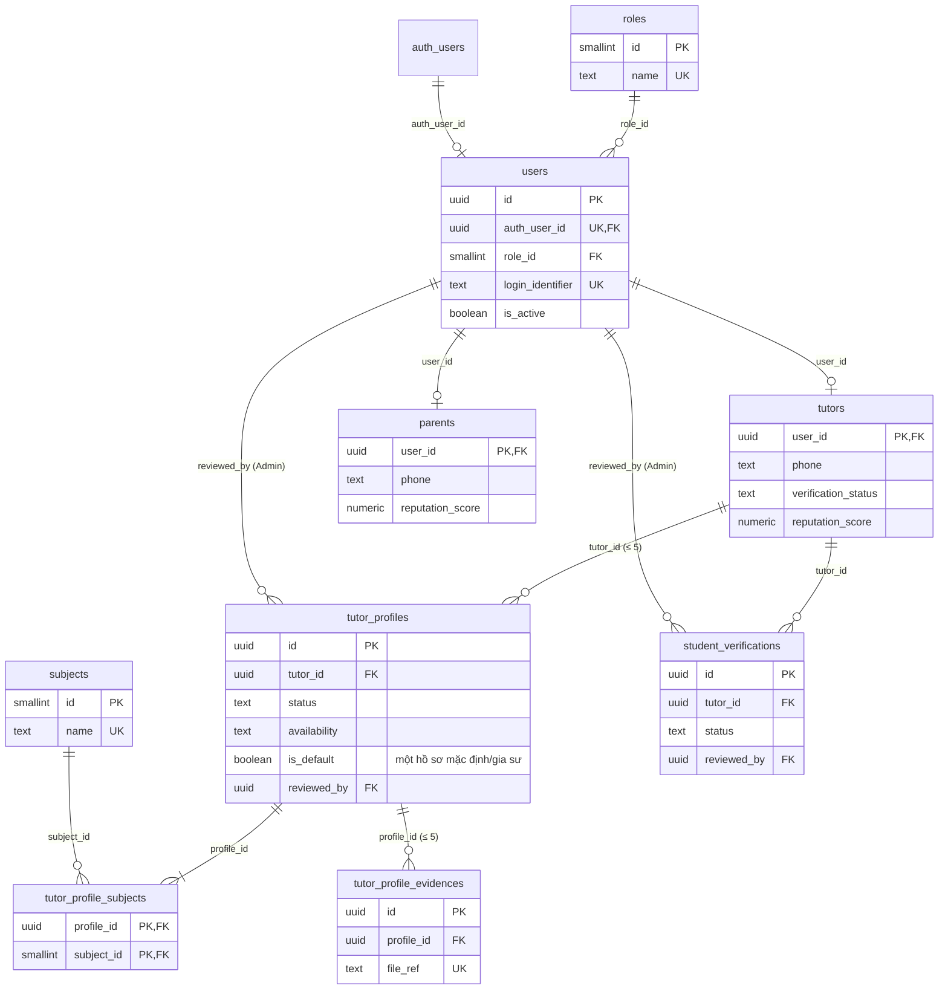
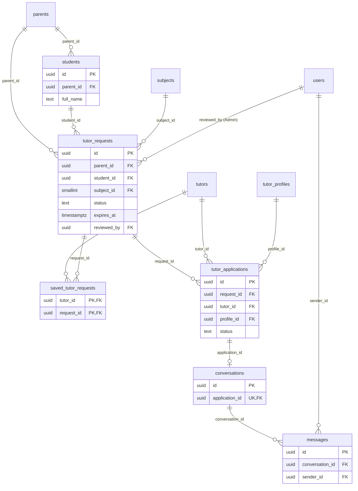
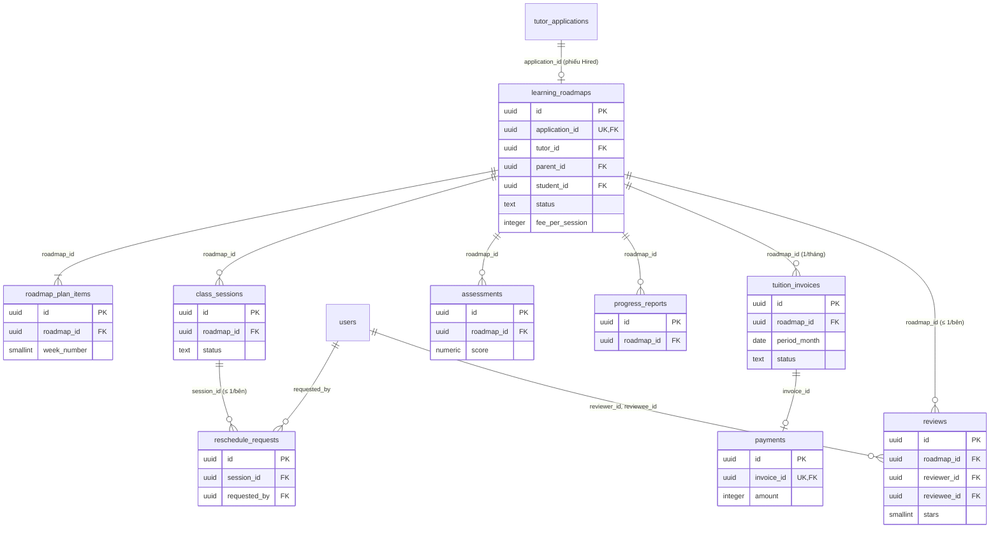
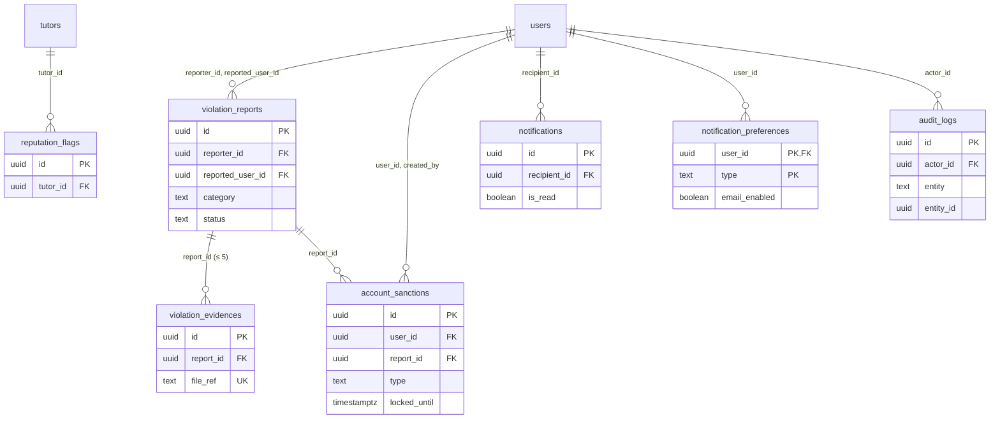

# Thiết kế database

ERD toàn hệ thống do SV3 chốt (S01-06). Migration Alembic từng bảng do người làm module tạo theo
đúng thiết kế ở đây (D11); muốn đổi bảng, cột hay quan hệ thì sửa file này trước, cùng PR với
migration. Sheet **P3D_04_CoSoDuLieu** của biểu mẫu chép lại từ file này.

Trạng thái và quy tắc: `business/business-rules.md`. Tên lớp: `DECISIONS.md` D18. Khu vực: D37.

## 1. Quy ước

- Tên bảng snake_case số nhiều; khóa chính `id uuid` (riêng `roles`, `subjects` dùng `smallint`,
  bảng 1–1 với `users` dùng `user_id` làm khóa chính). Bảng nối N–N dùng khóa chính ghép.
- Thời gian `timestamptz`, tên kết thúc `_at`, lưu UTC; ngày không giờ dùng `date`.
- Tiền là `integer` số đồng (không dùng số thực). Tên tỉnh/thành, trạng thái, giá trị liệt kê lưu
  `text` + `CHECK` (không dùng kiểu `enum` của PostgreSQL vì thêm giá trị cần migration khó hoàn tác).
- Khóa ngoại mặc định `ON DELETE RESTRICT`; không xóa cứng dữ liệu nghiệp vụ (CC-05). Hai ngoại lệ:
  minh chứng của hồ sơ chưa duyệt (BR-26) và tin đã lưu (FR-34).
- Mọi khóa ngoại có index (khóa chính ghép bắt đầu bằng cột đó cũng tính).
- `CHECK` viết trong migration (không khai báo trong model SQLAlchemy); tên ràng buộc theo mẫu
  `pk_`, `fk_`, `ix_`, `ux_` (unique index), `ck_` + tên bảng + cột.

## 2. Sơ đồ ERD

Ký hiệu crow's foot: `||` đúng một, `o|` không hoặc một, `o{` không hoặc nhiều, `|{` một hoặc
nhiều. Sơ đồ chỉ ghi khóa và cột quyết định quan hệ/trạng thái; đủ cột ở §3, §4.
`auth_users` là bảng `auth.users` do Supabase Auth quản lý.

### 2.1 Tài khoản, hồ sơ gia sư, xác thực sinh viên

### 2.2 Tuyển dụng: học sinh, tin, ứng tuyển, chat

### 2.3 Học tập: lộ trình, buổi học, tiến độ, học phí, đánh giá

### 2.4 Vận hành: vi phạm, uy tín, thông báo, nhật ký

## 3. Bảng đã có migration

### 3.1 Tài khoản (`0001_initial_auth`, `0002_supabase_auth_mapping`)

| Bảng | Cột chính |
| :-- | :-- |
| `roles` | `id`, `name` — seed 3 vai trò (D05) |
| `auth.users` | Do Supabase Auth quản lý; `id uuid` là định danh xác thực, email/mật khẩu/refresh token không do backend nghiệp vụ ghi |
| `users` | `id` (định danh nghiệp vụ), `auth_user_id` (nullable trong bước chuyển tiếp, unique, FK `auth.users.id`), `role_id`, `full_name`, `login_identifier` (email cũ, unique), `credential_reference` (hash cũ, nullable), `is_active`, `token_version` (cột cũ), `created_at` |

`0001_initial_auth` tái hiện đúng schema EF `InitialAuth` để Alembic có baseline. `0002` chỉ thêm
ánh xạ Supabase và nới nullable cho hash cũ, không đổi/xóa `id`, `credential_reference`,
`token_version` hay dữ liệu hiện có. Sau khi S01-04 hoàn tất chuyển tài khoản và mọi row có
`auth_user_id`, một migration riêng mới được phép đặt cột này `NOT NULL`; PR nền hiện tại chưa làm.

Quan hệ xác thực là `auth.users (1) — (0..1) users`. Xóa user Supabase bị `RESTRICT`; khóa tài
khoản nghiệp vụ dùng `users.is_active`, vai trò dùng `users.role_id`.

Sheet **P3D_04_CoSoDuLieu** mô tả mô hình đích gọn hơn: `users.id` đồng thời là FK đến
`auth.users.id`, và `status` biểu diễn trạng thái tài khoản. Với dữ liệu `InitialAuth` đã tồn tại,
đổi trực tiếp PK sẽ làm mất liên kết nên migration chuyển tiếp cố ý giữ `users.id`, thêm
`auth_user_id`, và ánh xạ `status` sang `is_active`. Sau khi S01-04 hoàn tất backfill, nhóm phải
chốt một migration riêng nếu muốn hợp nhất hai UUID; không thực hiện việc đó trong PR nền này.

### 3.2 Hồ sơ vai trò và danh mục môn (`0003_tutors_parents_subjects`)

| Bảng | Cột | Ràng buộc |
| :-- | :-- | :-- |
| `tutors` | `user_id uuid` PK, FK `users.id` · `phone text` · `verification_status text` mặc định `Unverified` · `reputation_score numeric(5,2)` null = chưa tính | `ck_tutors_phone`: `^0[0-9]{9}$` (BR-01) · `verification_status` ∈ §2.2 business-rules · `reputation_score` 0–100 (D30) |
| `parents` | `user_id uuid` PK, FK `users.id` · `phone text` · `reputation_score numeric(5,2)` | như `tutors` |
| `subjects` | `id smallint` PK (không tự tăng) · `name text` | `ux`: `name` unique; seed 22 môn (Toán, Tiếng Việt, Ngữ văn, Tiếng Anh, Vật lý, Hóa học, Sinh học, Khoa học tự nhiên, Lịch sử, Địa lý, Tin học, Tiếng Trung, Tiếng Nhật, Tiếng Hàn, Tiếng Pháp, IELTS, TOEIC, Luyện chữ đẹp, Vẽ, Piano, Guitar, Lập trình) |

`tutors`/`parents` được tạo cùng `users` khi đăng ký (S01-04, FR-01). Thêm môn mới bằng migration
với `id` kế tiếp, không sửa hay xóa môn đã có (FK `RESTRICT` từ hồ sơ và tin).

### 3.3 Hồ sơ gia sư (`0004_tutor_profiles`)

| Bảng | Cột | Ràng buộc |
| :-- | :-- | :-- |
| `tutor_profiles` | `id uuid` PK · `tutor_id uuid` FK `tutors.user_id` · `title text` · `description text` null (giới thiệu, kinh nghiệm) · `education_level text` · `teaching_mode text` · `province text` · `teaching_wards text[]` · `expected_fee_per_session integer` · `status text` (`Draft`) · `availability text` (`Accepting`) · `is_default boolean` · `reject_reason text` null · `submitted_at timestamptz` null (lần gửi duyệt gần nhất) · `reviewed_by uuid` null FK `users.id` · `reviewed_at timestamptz` null (lần duyệt/từ chối gần nhất) · `created_at`, `updated_at timestamptz` | `ix` `tutor_id`, `reviewed_by`; `ux_tutor_profiles_tutor_id_default` unique (`tutor_id`) `WHERE is_default` (BR-02); CHECK: `status`, `availability`, `education_level`, `teaching_mode` thuộc §2 business-rules; `province` thuộc 34 giá trị D37; `title` 10–150 ký tự; `description` ≤ 2000; học phí 50.000–2.000.000, bội số 1.000; `teaching_wards` ≤ 5 phần tử và ≥ 1 khi không phải `Online`; `Rejected` phải có `reject_reason` ≤ 500; `Approved`/`Rejected` phải có `reviewed_by`, `reviewed_at` (BR-04, BR-05) |
| `tutor_profile_subjects` | `profile_id uuid` FK · `subject_id smallint` FK | PK (`profile_id`, `subject_id`); `ix` `subject_id` |
| `tutor_profile_evidences` | `id uuid` PK · `profile_id uuid` FK · `file_ref text` (đường dẫn object trong bucket private) · `file_name text` · `content_type text` · `size_bytes integer` · `created_at timestamptz` | `ix` `profile_id`; `ux` `file_ref`; `content_type` ∈ JPG/PNG/PDF; `size_bytes` 1–5.242.880; `file_name` 1–255 ký tự (BR-03, D16) |

Giới hạn 5 hồ sơ/gia sư (BR-23) và 5 minh chứng/hồ sơ (BR-03) kiểm ở service dưới khóa dòng
(`SELECT … FOR UPDATE` trên `tutors` / `tutor_profiles`), vì PostgreSQL không có CHECK đếm dòng.

## 4. Bảng của các module sau (chưa có migration)

Người làm module tạo migration theo đúng bảng dưới đây; cột nào FR chi tiết cần thêm thì sửa ở
đây trong cùng PR.

| Bảng | Cột chính | Quan hệ | Module |
| :-- | :-- | :-- | :-- |
| `students` | `id`, `parent_id`, `full_name`, `grade_level` (1–12, lớp đang học), `created_at` | N–1 `parents` | REQUEST |
| `student_verifications` | `id`, `tutor_id`, `university`, `student_code`, `evidence_file_ref`, `status`, `reject_reason`, `reviewed_by`, `reviewed_at`, `created_at`; unique (`tutor_id`) `WHERE status = 'Pending'` | N–1 `tutors`; `reviewed_by` N–1 `users` | VERIFY |
| `tutor_requests` | `id`, `parent_id`, `student_id`, `subject_id`, `education_level`, `teaching_mode`, `province`, `ward`, `address` (ba cột này `null` khi `Online`), `sessions_per_week`, `min_fee`, `max_fee`, `requirements`, `status`, `reject_reason`, `expires_at`, `submitted_at`, `reviewed_by`, `reviewed_at`, `created_at`, `updated_at` | N–1 `parents`, `students`, `subjects`; `reviewed_by` N–1 `users` | REQUEST |
| `saved_tutor_requests` | `tutor_id`, `request_id` (PK ghép), `saved_at` | N–N | SEARCH |
| `tutor_applications` | `id`, `request_id`, `tutor_id`, `profile_id`, `introduction`, `status`, `trial_scheduled_at`, `trial_note`, `created_at`, `updated_at` | N–1 `tutor_requests`, `tutors`, `tutor_profiles`; unique (`request_id`, `tutor_id`) `WHERE status IN ('Pending', 'Viewed', 'TrialInvited')` | APPLY |
| `conversations` | `id`, `application_id` (unique), `created_at` | 1–1 `tutor_applications` | CHAT |
| `messages` | `id`, `conversation_id`, `sender_id`, `content`, `sent_at` | N–1 `conversations`, `users` | CHAT |
| `learning_roadmaps` | `id`, `application_id` (unique), `tutor_id`, `parent_id`, `student_id`, `subject_id`, `goal`, `schedule_note`, `fee_per_session`, `start_date`, `end_date`, `status`, `parent_feedback` | 1–1 `tutor_applications` | ROADMAP |
| `roadmap_plan_items` | `id`, `roadmap_id`, `week_number`, `planned_content`, `planned_sessions`, `is_done` | N–1 `learning_roadmaps` | ROADMAP |
| `class_sessions` | `id`, `roadmap_id`, `scheduled_start_at`, `scheduled_end_at`, `status`, `taught_content`, `homework`, `understanding_level`, `tutor_note`, `recorded_at`, `confirmed_at`, `dispute_reason` | N–1 `learning_roadmaps` | SESSION |
| `reschedule_requests` | `id`, `session_id`, `requested_by`, `proposed_start_at`, `proposed_end_at`, `reason`, `status`, `created_at` | N–1 `class_sessions`, `users`; unique (`session_id`, `requested_by`) | SESSION |
| `assessments` | `id`, `roadmap_id`, `title`, `test_date`, `score`, `target_score`, `note` | N–1 `learning_roadmaps` | PROGRESS |
| `progress_reports` | `id`, `roadmap_id`, `period_start`, `period_end`, `sessions_completed`, `plan_completion_percent`, `average_score`, `is_behind_schedule`, `tutor_comment`, `generated_at` | N–1 `learning_roadmaps` | PROGRESS |
| `tuition_invoices` | `id`, `roadmap_id`, `period_month`, `session_count`, `amount`, `due_date`, `status` | N–1 `learning_roadmaps`; unique (`roadmap_id`, `period_month`) | TUITION |
| `payments` | `id`, `invoice_id` (unique), `amount`, `method`, `transaction_code`, `recorded_by`, `paid_at`, `confirmed_by_tutor_at` | 1–1 `tuition_invoices` | TUITION |
| `reviews` | `id`, `roadmap_id`, `reviewer_id`, `reviewee_id`, `stars`, `comment`, `reply`, `replied_at`, `created_at` | N–1 `learning_roadmaps`, `users`; unique (`roadmap_id`, `reviewer_id`) | REVIEW |
| `reputation_flags` | `id`, `tutor_id`, `reason`, `created_at`, `handled_at` | N–1 `tutors` | REVIEW |
| `violation_reports` | `id`, `reporter_id`, `reported_user_id`, `category`, `description`, `status`, `resolution`, `handled_by`, `created_at`, `resolved_at` | N–1 `users` | VIOLATION |
| `violation_evidences` | `id`, `report_id`, `file_ref` (unique), `file_name` | N–1 `violation_reports` | VIOLATION |
| `account_sanctions` | `id`, `user_id`, `report_id`, `type` (`Warning`, `FeatureLock`, `PermanentBan`), `locked_until`, `reason`, `created_by`, `created_at` | N–1 `users`, `violation_reports` | VIOLATION |
| `notifications` | `id`, `recipient_id`, `type`, `title`, `message`, `link`, `is_read`, `created_at`; index (`recipient_id`, `is_read`, `created_at`) | N–1 `users` | NOTI |
| `notification_preferences` | `user_id`, `type` (PK ghép), `email_enabled` | N–1 `users` | NOTI |
| `audit_logs` | `id`, `actor_id`, `entity`, `entity_id`, `action`, `from_status`, `to_status`, `created_at`; index (`entity`, `entity_id`) | N–1 `users` | dùng chung (BR-22) |

Ràng buộc nên đặt ở database (CHECK), không chỉ ở validator: các cột `status`, `stars` 1–5,
`score` 0–10, `understanding_level` 1–5, `min_fee <= max_fee`, `amount >= 0`, `province` thuộc danh mục D37,
`grade_level` 1–12, `sessions_per_week` 1–7.

`submitted_at` là lần gửi duyệt gần nhất (danh sách chờ duyệt của Admin sắp theo cột này);
`reviewed_by`, `reviewed_at` là lần duyệt/từ chối gần nhất (FR-04, FR-06).

## 5. Khác với bản phác

| Chỗ | Bản phác | Bản chốt | Lý do |
| :-- | :-- | :-- | :-- |
| `subjects.education_level` | có | bỏ | Một môn dạy ở nhiều cấp; cấp học đã nằm ở hồ sơ (`tutor_profiles`) và tin (`tutor_requests`). Giữ cột sẽ phải nhân bản "Toán" theo từng cấp và matching D25 không còn so được theo môn. |
| `tutor_profiles.experience` | có | bỏ | SCR-TUT-02 và BR-04 chỉ có một ô "Giới thiệu, kinh nghiệm" (≤ 2000 ký tự) = `description`. |
| `tutor_profiles.submitted_at`, `reviewed_by`, `reviewed_at` | không | thêm | Admin xếp hàng chờ theo lần gửi duyệt và xem người, lúc duyệt gần nhất (FR-04 phía Admin, SCR-ADM-02). |
| `tutor_profile_evidences.created_at`, `file_ref` unique | không | thêm | Sắp xếp minh chứng; một object trong bucket chỉ thuộc một bản ghi. |
| Mặc định hồ sơ | chỉ quy tắc BR-02 | unique index một phần `WHERE is_default` | DB tự bảo đảm "đúng một hồ sơ mặc định" kể cả khi hai request chạy cùng lúc (AC-PROFILE-03). |
| `students.created_at`, `tutor_requests.updated_at` | không | thêm | Sắp xếp danh sách; tin `Recruiting` sửa nội dung phải về `PendingReview` (D33). |
| `student_verifications` | không ràng buộc | unique `tutor_id` `WHERE status = 'Pending'` | Mỗi lúc chỉ một yêu cầu `Pending` (§2.2 business-rules). |
| `audit_logs` | không index | index (`entity`, `entity_id`) | Xem lịch sử một bản ghi khi xử lý vi phạm (FR-31). |
